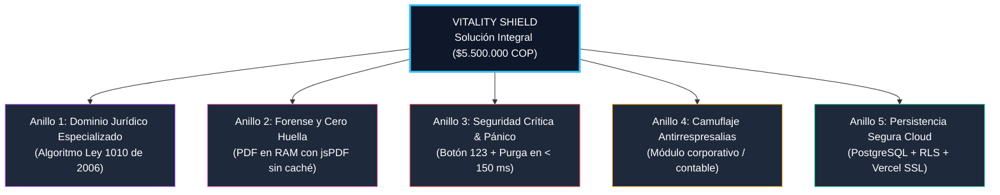

# 📑 INFORME EJECUTIVO: MODELO DE ESTIMACIÓN Y FIJACIÓN DE PRECIOS EN SOFTWARE
## Caso de Estudio Académico y Práctico: Plataforma "Vitality Shield" (Ley 1010 de 2006)
### Asignatura / Taller: Ingeniería Económica, Gestión de Proyectos TI y Monetización de Software

---

## 🎯 1. Resumen Ejecutivo (El Dilema del Precio)

Uno de los errores más comunes de los ingenieros y desarrolladores en etapas iniciales (Junior) es **cobrar exclusivamente por el tiempo cronológico invertido frente a la pantalla** (*Modelo Cost-Plus / Horas Hombre*). 

Bajo la irrupción de herramientas de desarrollo asistido con Inteligencia Artificial, cobrar por hora se convierte en un **auto-castigo financiero**: a mayor eficiencia y velocidad del programador, menores serían sus ingresos si cobrara por tiempo.

El presente informe expone cómo justificar un precio de venta entre **$4.500.000 y $6.000.000 COP** para el aplicativo web **Vitality Shield**, transitando desde el modelo tradicional de horas hacia el modelo moderno de **Fijación de Precios Basada en Valor (*Value-Based Pricing*)** y **Venta por Anillos de Solución**.

---

## ⚖️ 2. Modelo 1: La Trampa de Cobrar por Horas (Cost-Plus Pricing)

En el enfoque tradicional de costos:

$$\text{Precio} = \text{Horas Trabajadas} \times \text{Tarifa Hora} + \text{Costos Indirectos} + \text{Margen}$$

Si un desarrollador junior realiza este proyecto a mano tradicional:
- **Horas requeridas:** 136 horas de codificación artesanal (~4 semanas).
- **Tarifa promedio junior (Colombia):** $28.000 COP / hora.
- **Costo Mano de Obra:** $3.808.000 COP.
- **Costos Indirectos + Margen (35%):** ~$1.800.000 COP.
- **Total Cotizado:** **~$5.600.000 COP**.

### ⚠️ La paradoja con herramientas de Inteligencia Artificial:
Si el mismo desarrollador utiliza herramientas de desarrollo acelerado y completa el software en **15 horas de supervisión y refinamiento**:
- Si cobrara por sus horas reales: $15 \text{ h} \times \$28.000 \text{ COP} = \mathbf{\$420.000\text{ COP}}$.
- **Consecuencia:** Estaría regalando una plataforma de nivel enterprise por el precio de una página web estática básica.
- **Lección clave para la clase:** **El cliente compra el producto terminado y la solución a su problema, no las horas que el programador pasó sudando frente al teclado.**

---

## 💎 3. Modelo 2: Fijación de Precio Basada en Valor (Value-Based Pricing)

En el **Value-Based Pricing**, el precio no se fija mirando el costo del proveedor, sino **el valor económico del problema que el software le soluciona al cliente**:

```
+-------------------------------------------------------------------------------+
|                       ECUACIÓN DE VALOR PARA EL CLIENTE                       |
|                                                                               |
|  Costo de una Demanda Laboral en Colombia:            $30.000.000 a $80.000.000|
|  Sanciones del Ministerio del Trabajo:                Hasta 5.000 SMLMV       |
|  Pérdida reputacional de la marca:                    Incalculable            |
|                                                                               |
|  PRECIO DE COMPRA DE VITALITY SHIELD:                 $5.000.000 COP          |
|  RETORNO DE INVERSIÓN (ROI) INMEDIATO:               > 600% a 1.500%          |
+-------------------------------------------------------------------------------+
```

Para una empresa en Colombia con 50 o 100 empleados, pagar **$5.000.000 COP** por este sistema representa una fracción mínima frente al riesgo legal que mitiga. El precio está plenamente justificado por el **costo del riesgo evitado**.

---

## 🛡️ 4. La Justificación Técnica: "Los 5 Anillos de Ingeniería"

Cuando se sustenta una cotización ante una junta directiva o cliente, no se mencionan librerías genéricas ni prompts. Se sustentan los **5 Anillos de Arquitectura Especializada** construidos en el código:



### Detalle de los 5 Anillos:

1. **Anillo 1: Inteligencia de Dominio Legal (Ley 1010 de 2006)**
   - *Por qué vale:* Codificar leyes colombianas en un algoritmo cuantitativo ponderado (0 a 100 PTS) que discrimine entre maltrato, persecución, discriminación, entorpecimiento, inequidad y desprotección.
   - *Valor atribuido:* **$1.300.000 COP**.

2. **Anillo 2: Privacidad Forense de Grado Crítico ("Zero-Trace PDF")**
   - *Por qué vale:* No usa visores estándar que dejan registros en el historial del navegador. Compila el vector gráfico en la memoria volátil del procesador, expide el Blob y revoca el ObjectURL al instante.
   - *Valor atribuido:* **$1.100.000 COP**.

3. **Anillo 3: Protocolo de Salvaguarda Física y Pánico Rápido**
   - *Por qué vale:* La función de pánico conecta directamente con la Central de Emergencias 123 de Colombia, ofrece salida por doble escape y purga atómicamente la sesión en menos de 150 milisegundos para evitar agresiones inmediatas.
   - *Valor atribuido:* **$900.000 COP**.

4. **Anillo 4: Sistema de Camuflaje Visual Anti-represalias**
   - *Por qué vale:* Permite a la usuaria alternar en milisegundos a una interfaz de auditoría contable/corporativa para evitar que compañeros o agresores descubran que está denunciando.
   - *Valor atribuido:* **$800.000 COP**.

5. **Anillo 5: Arquitectura en la Nube y Base de Datos Relacional**
   - *Por qué vale:* Infraestructura escalable sobre Supabase (PostgreSQL) con políticas Row Level Security (RLS) para cumplimiento de la Ley 1581 de 2012 (Habeas Data) y despliegue global en Vercel.
   - *Valor atribuido:* **$1.400.000 COP**.

$$\text{Valor Total Justificado por Anillos} = \mathbf{\$5.500.000\text{ COP}}$$

---

## 💼 5. Matriz de Negociación para la Clase (Cómo Defender la Cotización)

| Objeción del Cliente | Respuesta Tradicional (Mala) | Respuesta Profesional / Basada en Valor (Correcta) |
| :--- | :--- | :--- |
| *"¿Por qué tan caro si lo hiciste rápido?"* | *"Es que le dediqué muchas noches y fines de semana."* | *"Usted no está pagando por mi lentitud, está pagando por años de conocimiento condensados en entregarle una solución funcional, sin fallos y lista para proteger a su empresa desde hoy."* |
| *"Un sobrino me cobra $500.000 por una página web."* | *"Pero él no sabe programar como yo."* | *"Una página web informativa no procesa diagnósticos jurídicos, ni tiene protocolos forenses que soporten un juicio laboral, ni cuenta con políticas de seguridad bancaria RLS para evitar multas de la SIC."* |
| *"¿Me puedes rebajar el precio?"* | *"Bueno, te lo dejo en $3.000.000."* (Destruye tu credibilidad). | *"El precio de $5.500.000 incluye los 5 anillos. Si su presupuesto es menor, podemos retirar el generador de reportes PDF periciales o el soporte técnico de 60 días para ajustarnos a su número."* |

---

## 🎓 6. Conclusiones y Aprendizajes Pedagógicos

1. **El valor del software es intrínseco al resultado, no al esfuerzo:** Que una herramienta moderna permita construir código robusto en menos tiempo es una ventaja de margen para el desarrollador, nunca un descuento obligatorio para el cliente.
2. **El conocimiento de dominio multiplica el precio:** Un código que solo dice "Hola Mundo" vale cero. Un código que aplica con exactitud la Ley 1010 de 2006 y las normas del Ministerio del Trabajo adquiere estatus de herramienta corporativa.
3. **Vender tranquilidad es más rentable que vender código:** El cliente no compra 2.900 líneas de TypeScript; compra la tranquilidad de que su empresa no enfrentará un escándalo mediático ni una sanción millonaria por acoso laboral.
